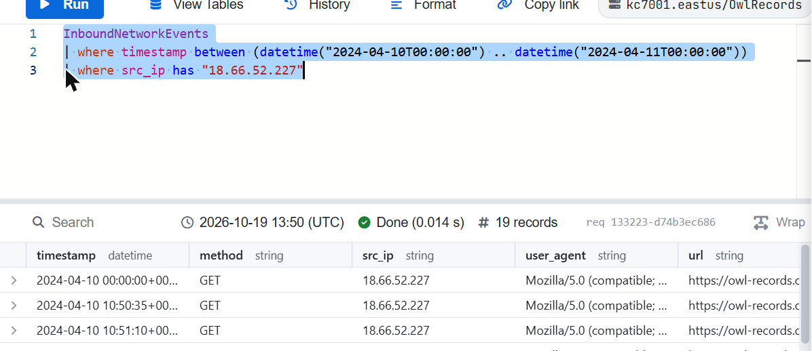
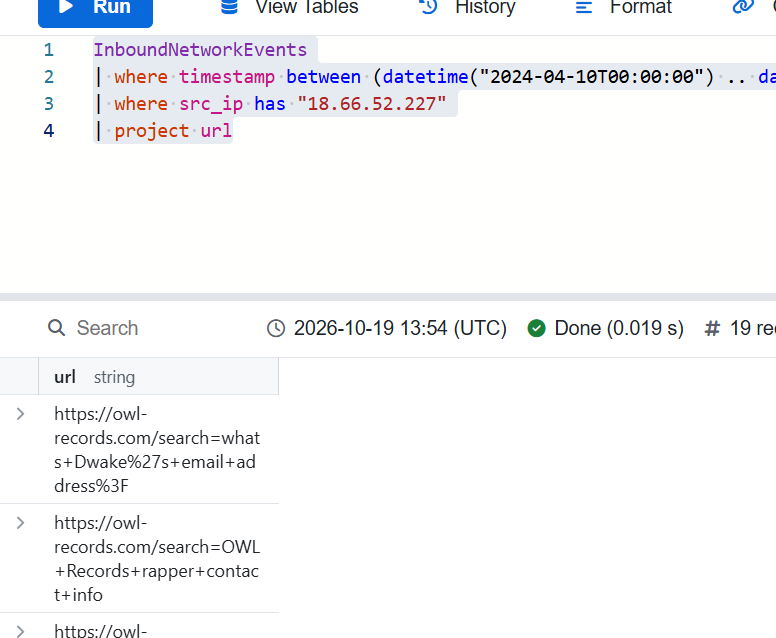
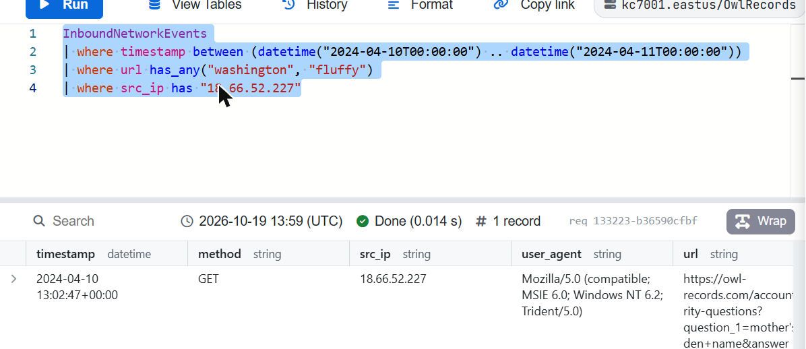
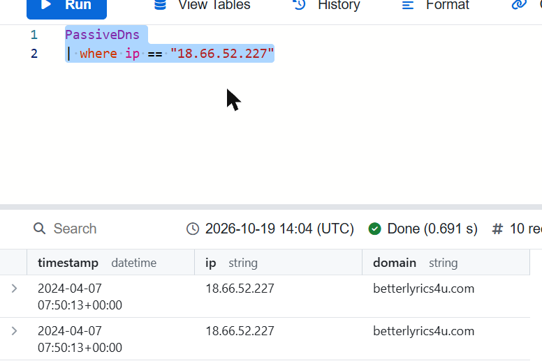
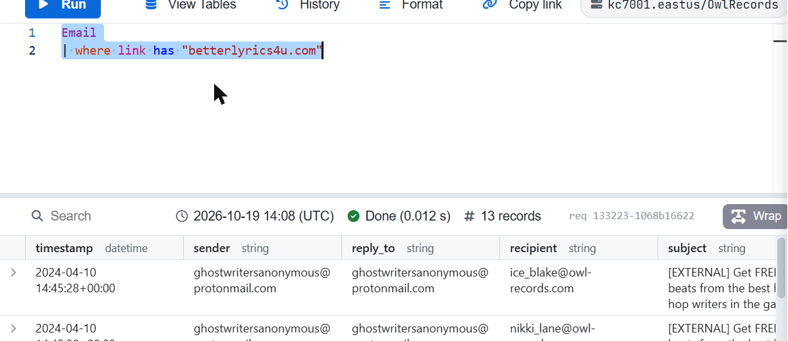
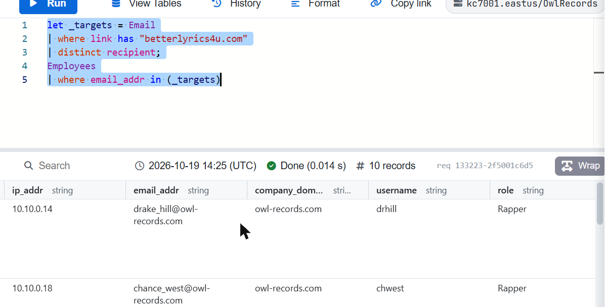
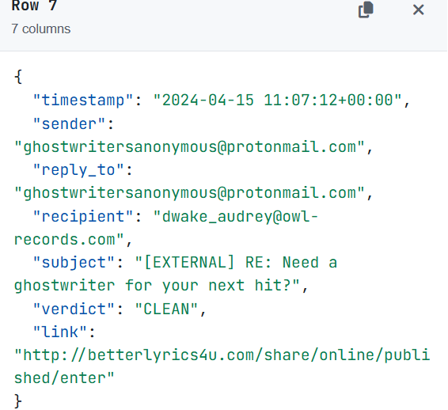
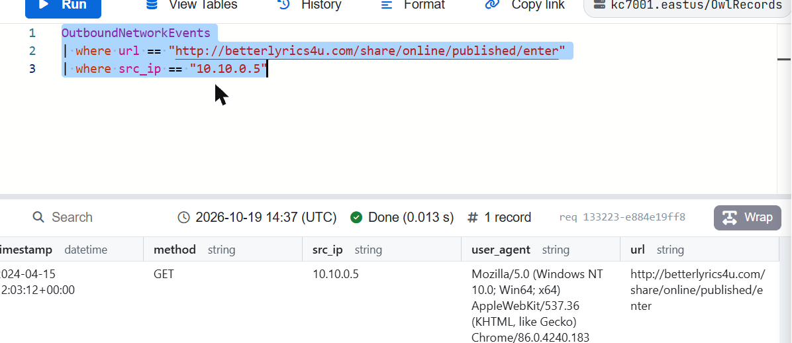
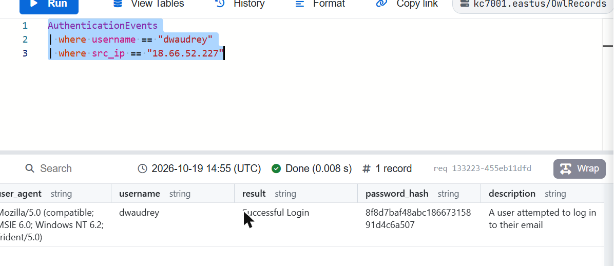
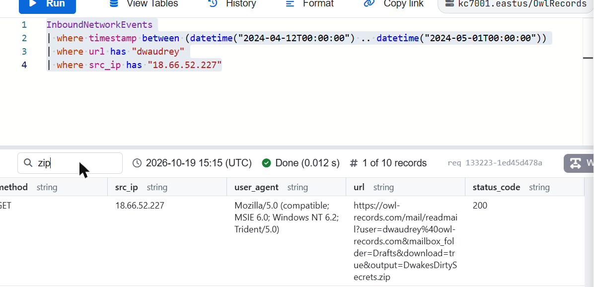

# Module 1 — A Rap Beef: An Intro to Security Investigations

> KC7 Security Analyst I path · Difficulty: Beginner · Path completed: October 2026 · Queries replayed on: 2026-10-19

## Scenario

OWL Records artist Dwake and Dollar Currency Records artist Present are in the middle of a public rap feud. Dwake fires the first shot with a diss track — but without realizing it, he reveals personal details about himself in his own lyrics (his mother's maiden name, his childhood pet's name). As the Security Analyst for OWL Records, I'm asked to investigate suspicious activity after a contact tips me off that the rival label may have hired someone to dig up dirt on Dwake, using the IP address `18.66.52.227`.

## Investigation objectives

- Confirm and scope reconnaissance activity from the tipped IP against the OWL Records website.
- Determine how the attacker obtained enough information to take over Dwake's account.
- After a retaliatory dark-web threat against Present, trace a phishing campaign back to its infrastructure and confirm whether it succeeded.
- Build a timeline from initial click to credential validation to data theft.

## Approach

### Step 1 — Scope the reconnaissance activity
**Hypothesis:** if a hacker used `18.66.52.227` to scout the OWL Records site, that traffic should show up in the web server logs.
**Table used:** `InboundNetworkEvents` — this table logs HTTP requests made to OWL Records' own website.
```kql
InboundNetworkEvents
| where timestamp between (datetime("2024-04-10T00:00:00") .. datetime("2024-04-11T00:00:00"))
| where src_ip has "18.66.52.227"
```
**Result:** 19 requests on 2024-04-10, all from `18.66.52.227`.



**What I conclude / next pivot:** the tip checks out — this IP really was actively browsing the site that day. Next I need to see *what* they were looking for.

### Step 2 — Read what the operator searched for
**Hypothesis:** the `url` field of each request should show search queries typed into the site's search bar.
**Table used:** same `InboundNetworkEvents` query, projected down to the `url` column.
```kql
InboundNetworkEvents
| where timestamp between (datetime("2024-04-10T00:00:00") .. datetime("2024-04-11T00:00:00"))
| where src_ip has "18.66.52.227"
| project url
```
**Result:** the URLs show search terms like `what's Dwake's email address?` and `OWL Records rapper contact info`.



**What I conclude / next pivot:** the operator was hunting specifically for Dwake's email address — a clear sign this was targeted, not random browsing. That address turned out to be `dwake_audrey@owl-records.com`.

### Step 3 — Find the account takeover
**Hypothesis:** Dwake's diss track accidentally answered OWL Records' password-reset security questions (mother's maiden name = "Washington", childhood pet = "Fluffy"). If the attacker used those answers, the reset request should be logged with those values in the URL.
**Table used:** `InboundNetworkEvents`, filtered to URLs containing either leaked value.
```kql
InboundNetworkEvents
| where timestamp between (datetime("2024-04-10T00:00:00") .. datetime("2024-04-11T00:00:00"))
| where url has_any("washington", "fluffy")
| where src_ip has "18.66.52.227"
```
**Result:** one request at `2024-04-10 13:02:47Z`, a `GET` to `/account/security-questions` with both answers filled in.



**What I conclude / next pivot:** this confirms the account takeover vector — classic OSINT-enabled social engineering, no exploit needed. Dwake's own lyrics gave the attacker everything required to reset his password and, from there, his Instagram.

### Step 4 — Pivot from IP to phishing domain
**Hypothesis:** after a truce fell apart (a dark-web actor threatened Present), my contact hinted the retaliation would be a phishing campaign. Since I already have the attacker's IP, passive DNS should reveal what domain(s) it hosted.
**Table used:** `PassiveDns` — resolves historical IP-to-domain relationships.
```kql
PassiveDns
| where ip == "18.66.52.227"
```
**Result:** 10 records, all resolving to `betterlyrics4u.com`.



**What I conclude / next pivot:** I now have a domain to pivot into the email logs with.

### Step 5 — Find the phishing emails
**Hypothesis:** if `betterlyrics4u.com` is the phishing domain, emails containing links to it should be sitting in the `Email` table.
**Table used:** `Email`, filtered on the `link` column.
```kql
Email
| where link has "betterlyrics4u.com"
```
**Result:** 13 emails sent from two addresses, `ghostwritersanonymous@protonmail.com` and `wemakebeatz@gmail.com`, to various OWL Records staff.



**What I conclude / next pivot:** this is a real campaign, not a one-off. I need to know who was targeted and whether anyone bit.

### Step 6 — Identify the targets
**Hypothesis:** the campaign likely targeted specific roles (rappers) rather than the whole company.
**Table used:** a `let` variable to capture the recipient list from `Email`, joined against `Employees`.
```kql
let _targets = Email
| where link has "betterlyrics4u.com"
| distinct recipient;
Employees
| where email_addr in (_targets)
```
**Result:** 10 employees, almost all with the role `Rapper` — plus one `Lead Rapper`: Dwake Audrey (IP `10.10.0.5`).



**What I conclude / next pivot:** Dwake himself was targeted again. His email, subject (`[EXTERNAL] RE: Need a ghostwriter for your next hit?`) and phishing link (`http://betterlyrics4u.com/share/online/published/enter`) came straight from the `Email` table — and notably, the company's email security product marked it `CLEAN`.



### Step 7 — Confirm the click
**Hypothesis:** if Dwake clicked the link, it should appear in `OutboundNetworkEvents`, which records outbound link clicks from the OWL Records network.
**Table used:** `OutboundNetworkEvents`, filtered on the exact phishing URL and Dwake's internal IP.
```kql
OutboundNetworkEvents
| where url == "http://betterlyrics4u.com/share/online/published/enter"
| where src_ip == "10.10.0.5"
```
**Result:** one hit — Dwake clicked the link at `2024-04-15T12:03:12Z`.



**What I conclude / next pivot:** the email bypassed security controls and got a click. Next: did the attacker actually use the harvested credentials?

### Step 8 — Confirm credential validation
**Hypothesis:** if the attacker captured Dwake's credentials from the fake login page, they'd attempt to log in from their own IP shortly after.
**Table used:** `AuthenticationEvents`, filtered on Dwake's username and the attacker's IP.
```kql
AuthenticationEvents
| where username == "dwaudrey"
| where src_ip == "18.66.52.227"
```
**Result:** one `Successful Login` at `2024-04-15T13:03:12Z` — exactly one hour after the click.



**What I conclude / next pivot:** full account compromise confirmed, with a clean one-hour gap between click and login that fits a credential-harvesting-then-replay pattern.

### Step 9 — Find the exfiltration
**Hypothesis:** with access to Dwake's mailbox, the attacker would search for something damaging and download it.
**Table used:** `InboundNetworkEvents`, filtered on activity against Dwake's account from the attacker's IP, over a wider window.
```kql
InboundNetworkEvents
| where timestamp between (datetime("2024-04-12T00:00:00") .. datetime("2024-05-01T00:00:00"))
| where url has "dwaudrey"
| where src_ip has "18.66.52.227"
```
**Result:** 10 requests — searches inside Dwake's mailbox for terms like "scandal" and "confidential", ending in a download from the Drafts folder: `DwakesDirtySecrets.zip`.



**What I conclude:** the attacker found and exfiltrated sensitive material from Dwake's own inbox, closing the loop on the retaliation campaign.

## Attack timeline

| Date/time (UTC) | Event | Source (table) |
|---|---|---|
| 2024-04-10, ~10:50 onward | Reconnaissance browsing of owl-records.com from `18.66.52.227` | InboundNetworkEvents |
| 2024-04-10 13:02:47 | Password reset on Dwake's account using leaked security-question answers | InboundNetworkEvents |
| (following day) | Dwake's Instagram compromised and defaced | (narrative, no query replayed) |
| 2024-04-15 11:07:12 | Phishing email "Need a ghostwriter for your next hit?" sent to Dwake, marked `CLEAN` by email security | Email |
| 2024-04-15 12:03:12 | Dwake clicks the phishing link | OutboundNetworkEvents |
| 2024-04-15 13:03:12 | Attacker logs in successfully to Dwake's account from `18.66.52.227` | AuthenticationEvents |
| 2024-04-12 – 2024-05-01 | Attacker searches Dwake's mailbox and downloads `DwakesDirtySecrets.zip` | InboundNetworkEvents |

## Indicators of Compromise (IOC)

| Type | Value | Context |
|---|---|---|
| IP | `18.66.52.227` | Attacker source IP across recon, account takeover, phishing infra and exfiltration |
| Domain | `betterlyrics4u.com` | Phishing domain, resolved from the attacker's IP |
| URL | `http://betterlyrics4u.com/share/online/published/enter` | Phishing landing page sent to Dwake |
| Email sender | `ghostwritersanonymous@protonmail.com` | Primary phishing sender address |
| Email sender | `wemakebeatz@gmail.com` | Secondary phishing sender address |
| Compromised account | `dwaudrey` / `dwake_audrey@owl-records.com` | OWL Records Lead Rapper, fully compromised |
| File | `DwakesDirtySecrets.zip` | Data exfiltrated from Dwake's mailbox |

## MITRE ATT&CK mapping

| Tactic | Technique (ID) | Observation |
|---|---|---|
| Reconnaissance | Gather Victim Identity Information (T1589) | Browsing the OWL Records site and reading lyrics to collect PII and the target's email address |
| Credential Access / Initial Access | Valid Accounts (T1078) | Password reset abused using security-question answers leaked in public lyrics |
| Initial Access | Phishing: Spearphishing Link (T1566.002) | Email with a malicious link impersonating a "ghostwriter", bypassing the email security product |
| Collection | Email Collection (T1114) | Attacker searched Dwake's own mailbox for sensitive terms after logging in |
| Exfiltration | Exfiltration Over Web Service (T1567) | `DwakesDirtySecrets.zip` downloaded directly through the webmail interface |

*(Mapping is approximate — built for learning purposes, not a formal incident report.)*

## Defensive recommendations

- Stop using self-service security questions whose answers are easily guessable from public content (lyrics, social media, interviews); require a second factor instead.
- Tune the email security product: this phishing email was marked `CLEAN` despite an obviously suspicious external sender and link — investigate why it wasn't flagged.
- Add anomaly detection on successful logins shortly after a tracked outbound click on a known-bad or newly-registered domain.
- Monitor for unusual mailbox search activity and large attachment downloads, especially from Drafts/Sent folders, as a sign of post-compromise data staging.
- Run security-awareness training reminding talent and staff not to disclose personal "recovery" information publicly.

## What I learned

- Core KQL filtering (`where`, `has`, `has_any`, `between`, `project`) and how to pivot across tables using a shared IOC (an IP address) to rebuild an entire attack chain.
- How to use `let` to stage an intermediate result set (`_targets`) and feed it into a second query with `in()`.
- That a single piece of OSINT (lyrics revealing personal details) can defeat a "security question" control just as effectively as a technical exploit.
- The value of correlating multiple log sources (web, email, outbound clicks, authentication) to build a defensible, timestamped timeline rather than relying on a single data point.

## References

- KC7 Security Analyst I path — *A Rap Beef: An Intro to Security Investigations* (https://kc7cyber.com/dashboard/paths/security-analyst-i)
