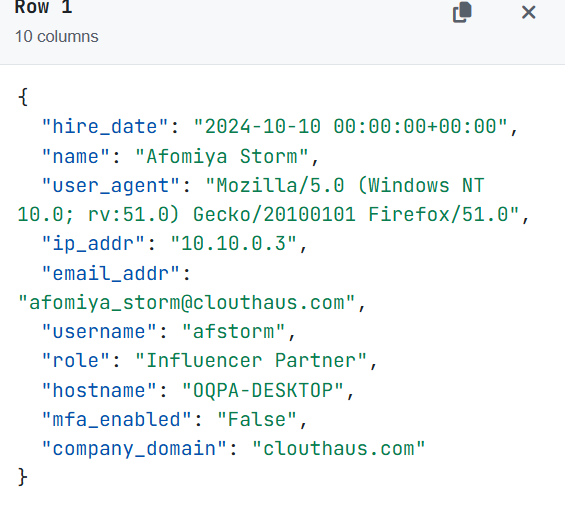
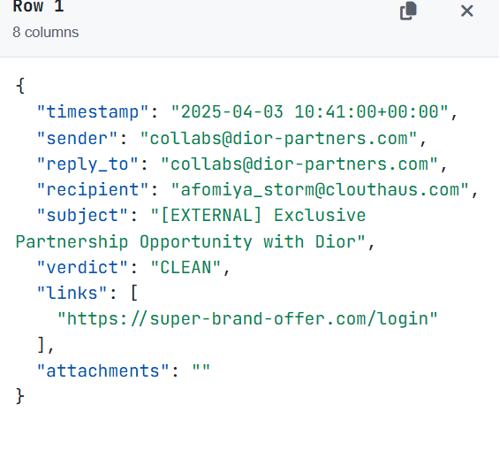
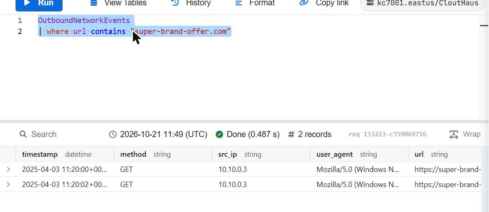
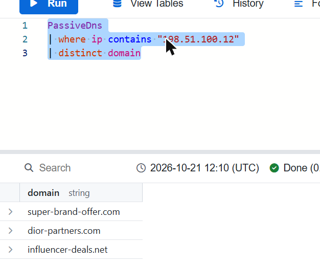
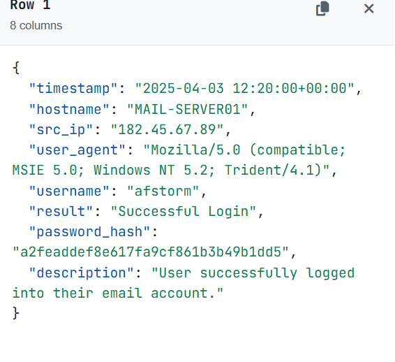
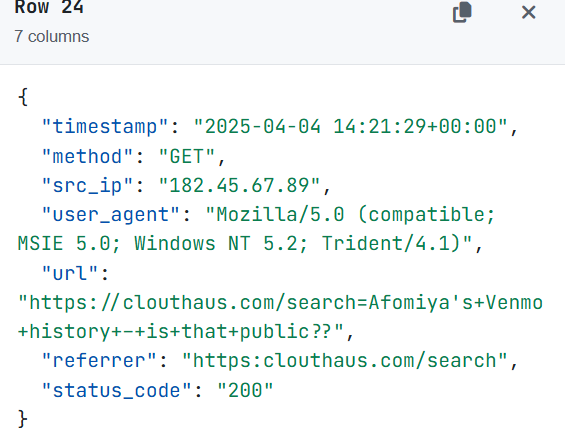
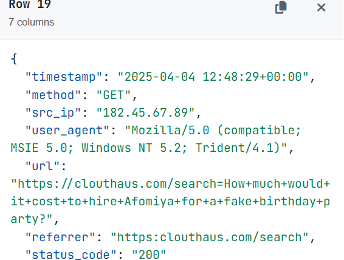
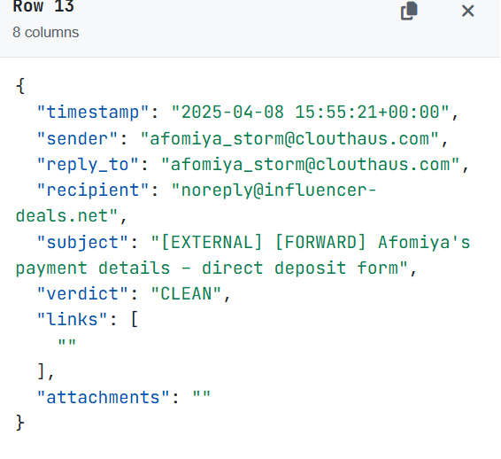
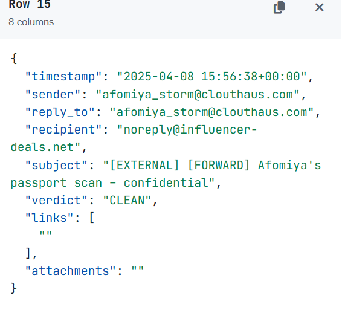

# Module 3 — CloutHaus: Social Media leads to Compromise

> KC7 Security Analyst I path · Difficulty: Beginner · Path completed: October 2026 · Queries replayed on: 2026-10-21

## Scenario

Afomiya Storm is a rising social media influencer who just joined CloutHaus, an influencer management agency, as an "Influencer Partner." A phishing email impersonating Dior lands in her inbox, she clicks the link and enters her credentials on a fake login page. As the analyst, my job is to trace the phishing attack, confirm how the attacker got in, and understand the full scope of the compromise before it spreads further.

## Investigation objectives

- Confirm Afomiya's identity, role, and security posture (MFA) inside CloutHaus.
- Trace the "Dior" phishing email back to its infrastructure and confirm the click.
- Pivot from that infrastructure to find the attacker's broader footprint.
- Determine whether the attacker actually got into Afomiya's company email, and if so, what they did with the access.

## Approach

### Step 1 — Establish Afomiya's identity and security posture
**Hypothesis:** her employee record should show whether her CloutHaus account had MFA enabled — a key factor, since her personal email was already protected by MFA and survived an earlier password-reset attempt.
**Table used:** `Employees` — the query KC7 teaches in this module to look someone up by name.
```kql
Employees
| where name contains "afomiya"
```
**Result:** email `afomiya_storm@clouthaus.com`, username `afstorm`, role `Influencer Partner`, and critically: `mfa_enabled: False`.



**What I conclude / next pivot:** unlike her personal email, her new CloutHaus account has no MFA — a single stolen password is enough to get in. Worth keeping in mind as I look for the phishing email.

### Step 2 — Find the Dior phishing email
**Hypothesis:** if an email claiming to be from Dior reached Afomiya's CloutHaus inbox, it should be sitting in the `Email` table addressed to her.
**Table used:** `Email`, filtered to her recipient address and a keyword match on the lure.
```kql
Email
| where recipient == "afomiya_storm@clouthaus.com"
| where subject contains "dior" or links contains "dior"
```
**Result:** sender `collabs@dior-partners.com`, subject `[EXTERNAL] Exclusive Partnership Opportunity with Dior`, verdict `CLEAN`, link `https://super-brand-offer.com/login`.



**What I conclude / next pivot:** the email security product marked this `CLEAN` despite an obvious domain mismatch (Dior's real partnership emails wouldn't come from `dior-partners.com`). Now I need to confirm whether she actually clicked it.

### Step 3 — Confirm the click
**Hypothesis:** a click on that link should show up as outbound traffic from Afomiya's own IP.
**Table used:** `OutboundNetworkEvents`, filtered on the suspicious domain.
```kql
OutboundNetworkEvents
| where url contains "super-brand-offer.com"
```
**Result:** two hits from `10.10.0.3` (Afomiya's IP), the first at `2025-04-03T11:20:00Z`.



**What I conclude / next pivot:** confirmed click. Time to see what other infrastructure this domain is tied to.

### Step 4 — Pivot the phishing domain to its hosting IP, then back out to sibling domains
**Hypothesis:** the phishing domain should resolve to an IP that may host other malicious domains — classic shared attacker infrastructure.
**Table used:** `PassiveDns`, first forward (domain → IP) then reverse (IP → all domains).
```kql
PassiveDns
| where domain contains "super-brand-offer.com"

PassiveDns
| where ip contains "198.51.100.12"
| distinct domain
```
**Result:** the domain resolves to `198.51.100.12`, which has also hosted `dior-partners.com` and — notably — `influencer-deals.net`.



**What I conclude / next pivot:** `influencer-deals.net` doesn't match anything I've seen yet, but I'm flagging it — it resurfaces later as the exfiltration endpoint, which is exactly the kind of connection this kind of infrastructure pivot is meant to surface.

### Step 5 — Find the suspicious login to Afomiya's company email
**Hypothesis:** if the stolen credentials were used, there should be a login to her account from an unfamiliar device around the same time as the click. KC7 doesn't print a query for this section, only a narrative hint ("check `AuthenticationEvents` for a login ~1h after the suspicious click"), so I started broad and narrowed from the results.
**Table used:** `AuthenticationEvents`, filtered to her username.
```kql
AuthenticationEvents
| where username == "afstorm"
```
**Result:** of 11 logins, one stands out — `2025-04-03T12:20:00Z` (almost exactly one hour after the click), from hostname `MAIL-SERVER01` (not her usual `OQPA-DESKTOP`), source IP `182.45.67.89`, user agent `Mozilla/5.0 (compatible; MSIE 5.0; Windows NT 5.2; Trident/4.1)` — a browser nobody has shipped in two decades — and result `Successful Login`.



**What I conclude / next pivot:** full compromise of her company email, roughly an hour after she handed over her credentials. A geolocation lookup on `182.45.67.89` placed it in Jinan, Shandong, China — nowhere Afomiya does business. Next: does this IP connect to the same infrastructure as the Dior phish?

### Step 6 — Pivot the attacker's login IP
**Hypothesis:** if this is the same operator, their login IP should resolve to the same (or overlapping) infrastructure as the phishing domain.
**Table used:** `PassiveDns`, same reverse-pivot pattern as Step 4.
```kql
PassiveDns
| where ip contains "182.45.67.89"
| distinct domain
```
**Result:** the same three domains — `super-brand-offer.com`, `dior-partners.com`, `influencer-deals.net`.
**What I conclude / next pivot:** this confirms it's one operator running the whole campaign from shared infrastructure, not two unrelated incidents. `influencer-deals.net` is now clearly on my radar.

### Step 7 — Attacker reconnaissance against the CloutHaus site
**Hypothesis:** before or after gaining access, the attacker likely searched the CloutHaus site for more information about Afomiya — a pattern already seen in this module's earlier recon.
**Table used:** `InboundNetworkEvents`, filtered to the attacker's IP.
```kql
InboundNetworkEvents
| where src_ip == "182.45.67.89"
```
**Result:** 27 requests, all from the same MSIE 5.0 user agent. Reading through the search URLs turns up, among others, `...Afomiya's+Venmo+history+-+is+that+public??` and `How+much+would+it+cost+to+hire+Afomiya+for+a+fake+birthday+party?` — alongside earlier searches for her location and home address.





**What I conclude / next pivot:** this isn't just account takeover — it's sustained profiling for financial fraud (Venmo) and physical/social engineering (a fake event to get close to her). With access confirmed and recon mapped, the last question is what the attacker actually took.

### Step 8 — Find the exfiltration
**Hypothesis:** with mailbox access, a quiet auto-forwarding rule is the stealthiest way to exfiltrate — and I already have a candidate destination from the earlier infrastructure pivot: `influencer-deals.net`.
**Table used:** `Email`, filtered to that domain as recipient.
```kql
Email
| where recipient == "noreply@influencer-deals.net"
```
**Result:** 21 forwarded emails, every one sent from `afomiya_storm@clouthaus.com` to herself and auto-copied out to `noreply@influencer-deals.net`. Two I confirmed directly:





Subject: `[EXTERNAL] [FORWARD] Afomiya's payment details – direct deposit form`, and `[EXTERNAL] [FORWARD] Afomiya's passport scan – confidential` — both marked `CLEAN`. The same forwarding rule also exfiltrated a bank statement and year-end tax documents, per the subject lines surfaced in the same result set.
**What I conclude:** the attacker didn't just read the mailbox — they set up silent, persistent exfiltration of Afomiya's most sensitive financial and identity documents, all while the email security product kept marking everything `CLEAN`.

## Attack timeline

| Date/time (UTC) | Event | Source (table) |
|---|---|---|
| (earlier) | Attacker gathers OSINT via a fake Instagram Q&A; a password-reset attempt on her *personal* email is blocked by MFA | (narrative, Section 1 Q3–Q5) |
| 2025-04-03 10:41:00 | "Dior" phishing email delivered to her CloutHaus inbox, marked `CLEAN` | Email |
| 2025-04-03 11:20:00 | Afomiya clicks the phishing link | OutboundNetworkEvents |
| 2025-04-03 12:20:00 | Attacker logs into her CloutHaus email successfully from `182.45.67.89` (China, MSIE 5.0) — no MFA to stop them | AuthenticationEvents |
| 2025-04-03 – 2025-04-04 | Attacker runs recon on the CloutHaus site: Afomiya's location, home address, Venmo history, a fake "birthday party" lure | InboundNetworkEvents |
| 2025-04-08 | Auto-forwarding rule exfiltrates 21 emails (payment details, passport scan, bank statement, tax documents) to `noreply@influencer-deals.net` | Email |
| (after) | Instagram also compromised via password reuse; attacker DMs followers for fake "investments" and brand reps for a fake delivery address | (narrative, Section 1 Q16–Q19) |

## Indicators of Compromise (IOC)

| Type | Value | Context |
|---|---|---|
| IP | `182.45.67.89` | Attacker login IP to Afomiya's company email (Jinan, Shandong, China) |
| IP | `198.51.100.12` | Hosting IP for the phishing domain, shared across the campaign |
| Domain | `super-brand-offer.com` | Fake Dior login page |
| Domain | `dior-partners.com` | Phishing sender domain, shares infrastructure with the above |
| Domain | `influencer-deals.net` | Exfiltration destination for the auto-forwarding rule; shares the same infrastructure |
| URL | `https://super-brand-offer.com/login` | Credential-harvesting page |
| Email sender | `collabs@dior-partners.com` | Dior-impersonation phishing sender |
| Exfil address | `noreply@influencer-deals.net` | Recipient of 21 auto-forwarded emails |
| User-Agent | `Mozilla/5.0 (compatible; MSIE 5.0; Windows NT 5.2; Trident/4.1)` | Consistent across the attacker's login and all 27 recon requests |
| Compromised account | `afstorm` / `afomiya_storm@clouthaus.com` | CloutHaus account, no MFA enabled |

## MITRE ATT&CK mapping

| Tactic | Technique (ID) | Observation |
|---|---|---|
| Reconnaissance | Gather Victim Identity Information (T1589) | OSINT via a fake Instagram Q&A, then direct recon on the CloutHaus site (location, address, Venmo, fake event lure) |
| Initial Access | Phishing: Spearphishing Link (T1566.002) | "Dior partnership" email with a credential-harvesting link, marked `CLEAN` by email security |
| Credential Access / Initial Access | Valid Accounts (T1078) | Stolen credentials used to log in to a company account with no MFA |
| Persistence / Collection | Email Forwarding Rule (T1114.003) | Auto-forwarding rule silently exfiltrating 21 emails over several days |
| Exfiltration | Exfiltration Over Web Service (T1567) | Forwarded documents (payment form, passport, bank statement, tax documents) routed to `influencer-deals.net` |

*(Mapping is approximate — built for learning purposes, not a formal incident report.)*

## Defensive recommendations

- Enforce MFA on every company account without exception — Afomiya's personal email survived an attack with the same stolen security-question answers specifically because it had MFA; her company account did not.
- Investigate why an email from a domain that doesn't match the brand it impersonates (`dior-partners.com` for "Dior") was marked `CLEAN`.
- Alert on new mailbox auto-forwarding rules, especially ones pointing to external, freshly-registered-looking domains — this is the single highest-leverage control that would have caught this exfiltration immediately.
- Monitor for authentication from anomalous user agents (very old browser/OS strings are themselves a red flag) and from geographies inconsistent with the employee's normal pattern.
- Correlate infrastructure across incidents: the same IP/domain cluster (`super-brand-offer.com`, `dior-partners.com`, `influencer-deals.net`) touched three separate parts of this attack — passive DNS pivoting should be a standard step, not an afterthought.

## What I learned

- How to pivot infrastructure bidirectionally with `PassiveDns` (domain → IP, then IP → every other domain it has hosted) to connect incidents that look unrelated at first glance.
- That KC7 doesn't always hand you the query — Section 2 of this module only gave hints, so I used `View Tables` to inspect each table's schema (`AuthenticationEvents`, `Email`, `InboundNetworkEvents`) and built my own queries, verifying each one against the known answer before trusting it.
- Auto-forwarding rules are a quiet, persistent exfiltration method precisely because they require no further login from the attacker — worth specifically hunting for after any confirmed email compromise.
- A missing MFA requirement on one account can undo the protection already in place on another — security posture has to be evaluated per account, not per person.

## References

- KC7 Security Analyst I path — *CloutHaus: Social Media leads to Compromise* (https://kc7cyber.com/dashboard/paths/security-analyst-i)
