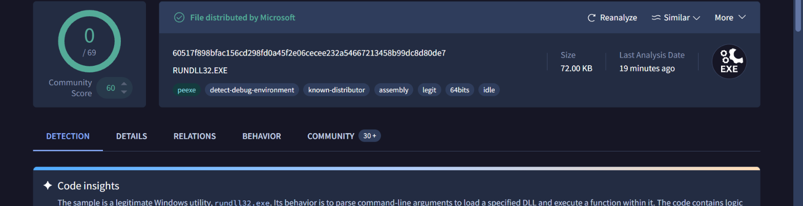
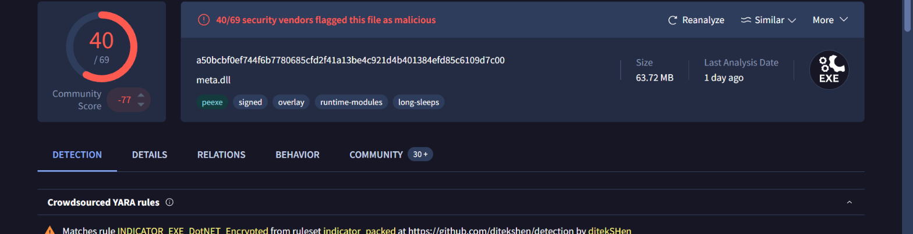
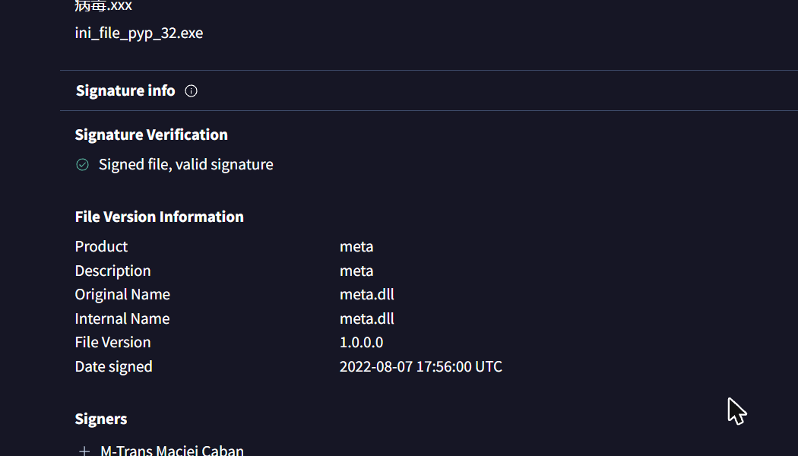
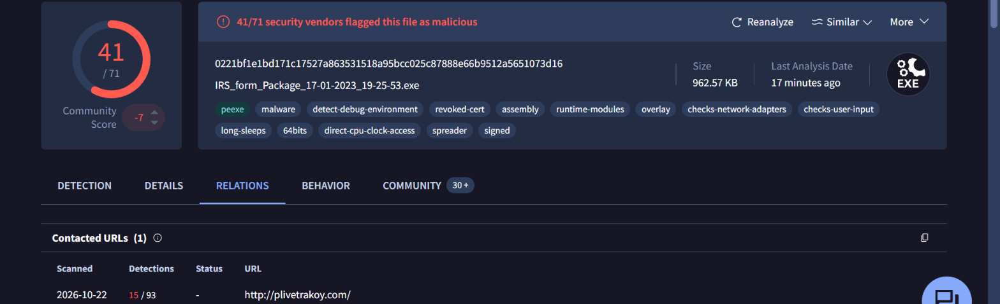
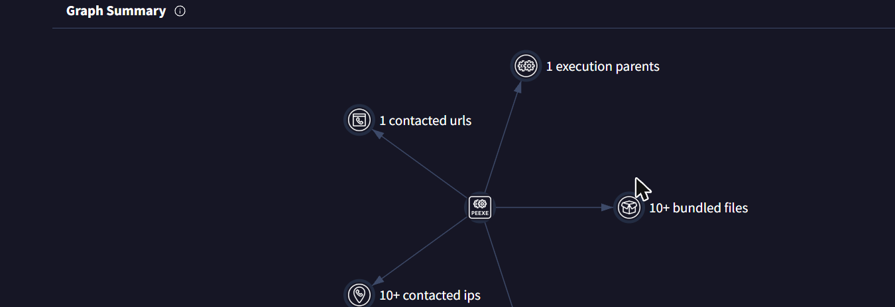
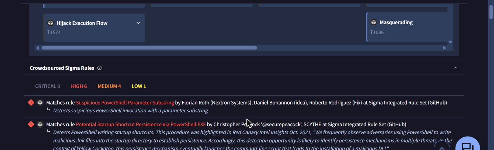

# Module 5 — VirusTotal Fundamentals

> KC7 Security Analyst I path · Difficulty: Beginner · Path completed: October 2026 · Replayed on: 2026-10-22

## About this module

Unlike the other modules in this path, there's no fictional company or KC7 dataset here — this module is a guided tour of the real [VirusTotal](https://www.virustotal.com) website, using a free account and real, publicly-known file hashes. Instead of one narrative, it's three short lessons (**101**, **102**, **103**) that build on each other through a single thread: several unrelated-looking malicious files turn out to share the same (likely purchased or stolen) code-signing certificate.

## What I learned

### 101 — Reading a file report (the benign case)
Starting point: `60517f898bfac156cd298fd0a45f2e06cecee232a54667213458b99dc8d80de7` — 0/69 detections, tagged `known-distributor`.

The header alone gives the detection ratio, a "meaningful name" (here `RUNDLL32.EXE`), tags, size, and last analysis date. The exercise's real point isn't "0 detections = safe" — it's that this *is* a legitimate Microsoft system binary, and legitimate binaries get abused constantly (masquerading — [T1036](https://attack.mitre.org/techniques/T1036/) — and DLL search-order hijacking — [T1574.001](https://attack.mitre.org/techniques/T1574/001/) — were both called out). The file's own upload history even showed it re-uploaded under a random-looking name (`rKpPlCbFgHgAfYwYlYjWu`) by someone else, for the exact same reason: an analyst shouldn't block a filename pattern without also checking the hash, or they'll eventually block a legitimate Windows process and cause an outage. One more small but useful detail: this file's metadata creation date reads 2040 — not suspicious here, since Microsoft deliberately bakes a fixed, often future-dated timestamp into certain builds to keep hashes reproducible.

### 102 — Pivoting from a shared certificate
This section's real lesson is a pivot chain, not a single lookup. It starts from a file signed by "Heart Craft Brewery s. r. o." — a brewery has no business signing software — and a second file claiming an Intel copyright but actually signed by "M-Trans Maciej Caban". That same signer then turns up again on a third hash, `a50bcbf0ef744f6b7780685cfd2f41a13be4c921d4b401384efd85c6109d7c00`, this time with a much higher detection count.

A crowdsourced YARA rule (`INDICATOR_EXE_DotNET_Encrypted`) flags encrypted .NET content, the popular threat label reads `trojan.stealer/msil`, and the file's upload history includes `install-ledger-win64.scr` — a fake Ledger (hardware crypto wallet) installer. VirusTotal's **Community** tab (collections/graphs other users built, and their comments) ties this specific sample to the **JuiceLedger** threat actor — information the raw detection engines don't surface on their own. A second sample (Batloader) only had 7/62 detections — inconclusive by the numbers alone — until a comment from a named Sophos analyst (`colinc_sophos`, real name verifiable from their public profile: Colin Cowie) explained what it was and how it spreads (fake software sites and malvertising, [T1583.008](https://attack.mitre.org/techniques/T1583/008/)). That's the core lesson of this section: **the community layer — comments, votes, collections — regularly carries information the automated engines miss**, but it also means a malicious actor could leave false "clean" comments, so a user's reputation (checked via their profile) matters as much as what they say.

The same certificate signer turns up a third time on `0221bf1e1bd171c17527a863531518a95bcc025c87888e66b9512a5651073d16`, uploaded as `IRS_form_Package_17-01-2023_19-25-53.exe` — a tax-season social-engineering lure — and identified via comments as **IcedID**.

From here the **Relations** tab turns one file hash into an entire pivot chain: the file contacts `plivetrakoy.com`, which passive DNS resolves to `193.149.180.175` around the same time the file was first submitted; every other file communicating with that IP is also flagged malicious ("All bad"); and the file's own **Execution Parent** — the archive it was extracted from during sandboxing — is `IRS_form_Package_17-01-2023_19-25-53 (1).zip`.

One hash, followed through domain → IP → sibling files → parent archive, turns into a small malware-delivery map.

### 103 — Reading sandbox behavior
The same certificate (now with a **revoked** status — a sign the issuer itself caught on) shows up a fourth time on `2bf0a64fe7aea262c96fc7d52b1e28486ff607caa9513fd88583e19454f9c500`, uploaded as `adverb-clause-definition-wikipedia.exe`. Its metadata creation date reads 1992 — again not actually suspicious, since every file built with that specific Delphi compiler version shares that exact timestamp.

The interesting part is evasion: the file is 301.35 MB, deliberately inflated past the size limit most sandboxes will process (VirusTotal's own analysis, with the padding stripped by a tool called Debloat, is only 2.52 MB). Restricting the **Behavior** tab to a single sandbox (`Dr.Web vxCube`, per this lesson's instructions) shows exactly why the file wanted to dodge automated analysis:

VirusTotal auto-tags the behavior with MITRE ATT&CK techniques (**Hijack Execution Flow** / T1574, **Masquerading** / T1036) and crowdsourced Sigma rules fire on exactly the persistence pattern this module walks through by hand: a file dropped into `%APPDATA%\Microsoft\Windows\Start Menu\Programs\Startup\` (anything there runs at every login), an `HKEY_CURRENT_USER` registry key under `shell\open\command` configured to launch `powershell`, AES-related strings written alongside it, and `powershell.exe` appearing as a child process in the process tree. Put together, that's a textbook persistence-and-execution chain, independently corroborated by the Sigma rule titled *"Potential Startup Shortcut Persistence Via PowerShell.EXE."*

## Indicators of Compromise (IOC)

| Type | Value | Context |
|---|---|---|
| SHA-256 | `a50bcbf0ef744f6b7780685cfd2f41a13be4c921d4b401384efd85c6109d7c00` | JuiceLedger stealer, masquerading as a Ledger installer |
| SHA-256 | `a54ca708c3bbef76dbaec817a9bb36d8b52e492b293d2127cd5be284caabb6d1` | Batloader, distributed via malvertising / fake software sites |
| SHA-256 | `0221bf1e1bd171c17527a863531518a95bcc025c87888e66b9512a5651073d16` | IcedID, distributed as a fake "IRS form package" |
| SHA-256 | `2bf0a64fe7aea262c96fc7d52b1e28486ff607caa9513fd88583e19454f9c500` | Inflated (301.35 MB) loader with Startup persistence, same cert, now revoked |
| Certificate signer | M-Trans Maciej Caban | Shared across at least 4 unrelated-looking malware samples |
| Domain | `plivetrakoy.com` | IcedID C2 |
| IP | `193.149.180.175` | Resolved to the C2 domain at time of first submission |
| Domain | `hire-recruit.org` | Hosting infrastructure referenced across the module's phishing lures |

## MITRE ATT&CK mapping

| Tactic | Technique (ID) | Observation |
|---|---|---|
| Defense Evasion | Masquerading (T1036) | Legitimate-looking filenames and copyright strings (Intel, Ledger) on unrelated malware |
| Persistence | Hijack Execution Flow: DLL Search Order Hijacking (T1574.001) | Named as a scenario for why a "known-distributor" file could still need scrutiny |
| Persistence | Boot or Logon Autostart Execution (via Startup folder) | File dropped into the Windows Startup folder, auto-flagged as Hijack Execution Flow (T1574) by VT |
| Resource Development | Acquire Infrastructure: Malvertising (T1583.008) | Batloader's distribution method per a trusted analyst's comment |
| Execution | Command and Scripting Interpreter: PowerShell | Registry `shell\open\command` key launches `powershell`; `powershell.exe` confirmed as a child process |

*(Mapping is approximate — built for learning purposes, not a formal incident report.)*

## Defensive recommendations

- Never trust a certificate signer at face value — cross-check the signer's name against what the file claims to be (a brewery signing an "Intel" tool, or a random individual's name on a "Ledger installer," are both immediate red flags).
- Track known-bad certificate signers as an indicator in their own right — in this module, one signer's name alone linked four otherwise-unrelated detections across three different malware families.
- Don't rely on detection ratio alone, especially for new or evasive samples — a 7/62 or a padded 300MB file can both look "mostly clean" to automated engines while being obviously malicious once the Community tab or Behavior tab is checked.
- Monitor for new files created under `%APPDATA%\...\Startup\` and new `HKCU\...\shell\open\command` registry writes — both are classic, easy-to-detect persistence techniques that showed up repeatedly in this module.
- When pivoting on an indicator (domain, IP, certificate), always check what else shares it — that's how a single file hash expanded into an entire delivery infrastructure map in this module.

## References

- KC7 Security Analyst I path — *VirusTotal Fundamentals* (https://kc7cyber.com/dashboard/paths/security-analyst-i)
- VirusTotal (https://www.virustotal.com) — file reports and lookups referenced above
- MITRE ATT&CK (https://attack.mitre.org) — technique IDs referenced above
