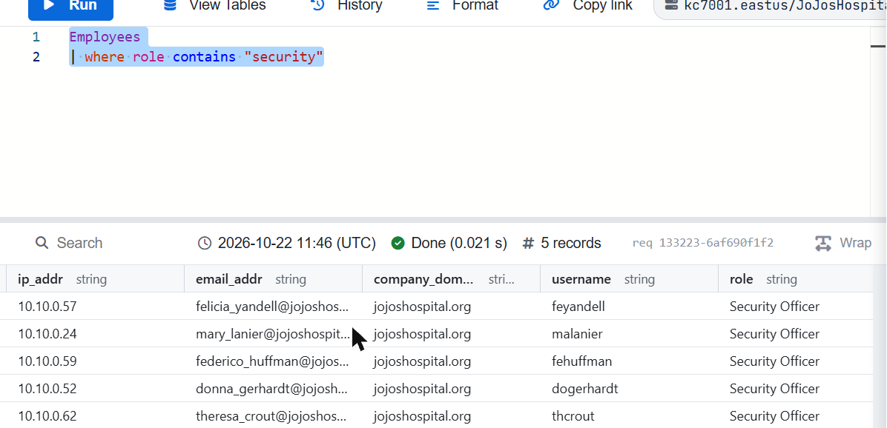
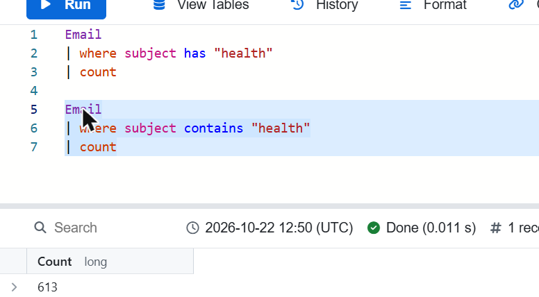
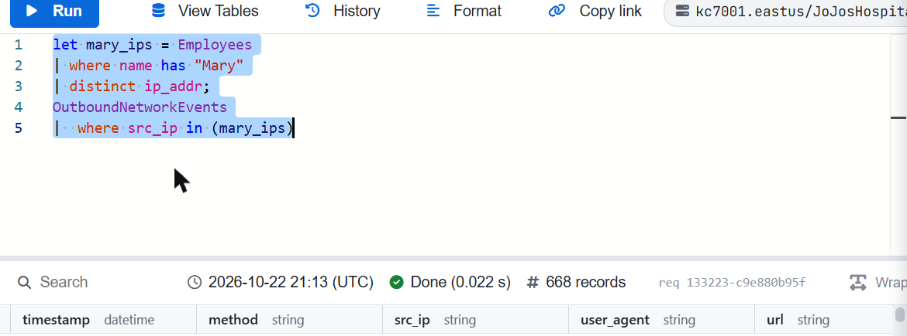
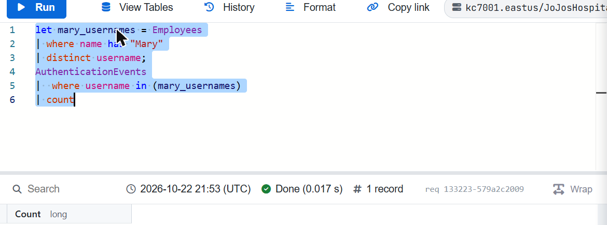

# Module 6: KQL 101: An Introduction to Kusto Query Language

> KC7 Security Analyst I path · Difficulty: Beginner · Path completed: October 2026 · Replayed on: 2026-10-22

## About this module

Like Module 2, this one has no fictional incident: it's a straight syntax course. It reuses the real **Jojo's Hospital** dataset (`kc7001.eastus/JoJosHospital`, the same company Module 7 investigates) purely as practice data, building up from "what's in a table" to a full tour of KQL operators.

## What I learned

### Which table answers which question
Section 1 isn't about writing queries at all: it's about matching a step in a generic intrusion to the table that would actually record it: a suspicious email → `Email`, a malicious link clicked → `OutboundNetworkEvents`, a file dropped to disk → `FileCreationEvents`, that file executed → `ProcessEvents`, and a security tool flagging it → `SecurityAlerts`. Knowing which table to open first is half of every investigation in this path.

### Rows, columns, and `take`
`Employees | take 10` returns exactly 10 rows, the cheapest way to see a table's shape before filtering anything. From there, `Employees | where role == "Pharmacist"` returns 19 pharmacists: the first real filter of the module, and a reminder that `==` only works once you know the exact string.

### count and distinct
Jojo's Hospital has 321 employees (`Employees | count`) across 23 distinct roles (`Employees | distinct role`). Two Radiologists are named Richard, and `Employees | where name == "Noemi Tep"` resolves to exactly one row and one email address.

### contains, and has vs. contains
`Employees | where role contains "security"` matches the role "Security Officer", a substring match, so it would also catch a role called "IT Security Analyst" if one existed.



The module's dedicated `has`-vs-`contains` example is `Email | where subject has "health"` compared to `... contains "health"`. I replayed both:



KC7's module only ever asks you to run the `has` version: the `contains` query is described narratively, as a "here's what you'd run into" cautionary example, not an actual exercise. Out of curiosity I ran `contains "health"` myself too, and it returned the same count, **613**, as `has`. So on this specific dataset, the gap KC7 describes (`contains` over-matching "Healthcare"/"Healthy") doesn't actually materialize; the subject lines here just don't happen to contain a counterexample. The underlying rule (`has` = whole word, `contains` = substring) is still correct: this dataset simply doesn't expose the gap between them, and that's a side observation from my own extra check, not a KC7-reported result.

### !contains, and / or, in
Filtering Noemi Tep's inbox with `!contains "jojoshospital"` surfaces every external sender she received mail from. The same lesson covers `and` (59 failed logins from a single IP), `or` (131 combined logins across two IPs), and `in (...)` (169 failed logins across four IPs), three ways of narrowing or widening the same kind of filter without nesting a long chain of `or`s.

### Pivoting across tables, with and without `let`
The last stretch is the actual payoff of the module: using one table's result to filter another. First without a variable: Nancy Roberts's IP address, looked up in `Employees`, is matched by hand against `OutboundNetworkEvents` to get her 80 distinct visited sites. Then with `let`, which names the intermediate result instead of requiring a value to be copy-pasted by hand:

```kql
let mary_ips = Employees
| where name has "Mary"
| distinct ip_addr;
OutboundNetworkEvents
| where src_ip in (mary_ips)
```



I replayed this one: **668** website-visit events logged by every employee named Mary, found without ever hand-typing an IP address. (First attempt, worth noting honestly: I initially appended `| distinct url | count` on top of KC7's own query, assuming "how many websites visited" meant unique URLs; that returned 594 and didn't match. Re-reading KC7's own example query line by line showed it stops at the raw `OutboundNetworkEvents` rows filtered by `mary_ips`, with no `distinct`/`count` added: the question is asking for the number of visit *events*, not the number of distinct sites. Re-running the exact query as KC7 wrote it gives 668, matching the module's own recorded answer.)

The module immediately reinforces the same pattern a second time, swapping the target table and field, same `mary_` variable idea, but pulling `username` instead of `ip_addr` from `Employees`, then filtering `AuthenticationEvents` instead of `OutboundNetworkEvents`:

```kql
let mary_usernames = Employees
| where name has "Mary"
| distinct username;
AuthenticationEvents
| where username in (mary_usernames)
| count
```



**810** authentication attempts across every Mary's account, matching KC7's answer exactly this time, no correction needed, since I built this one straight from KC7's own displayed example instead of improvising an ending. That's the actual skill the whole module was building toward: `count`, `distinct`, `where`, `has`/`contains`, `and`/`or`/`in` all exist to make a pivot like this one possible, and these two `let` queries are the first in the path that chain two tables together through a named variable instead of a hardcoded value.

## References

- KC7 Security Analyst I path: *KQL 101: An introduction to Kusto Query Language* (https://kc7cyber.com/dashboard/paths/security-analyst-i)
