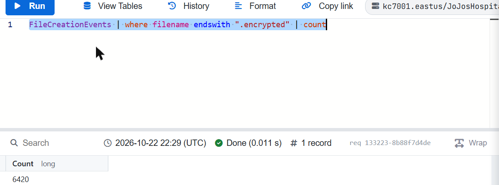
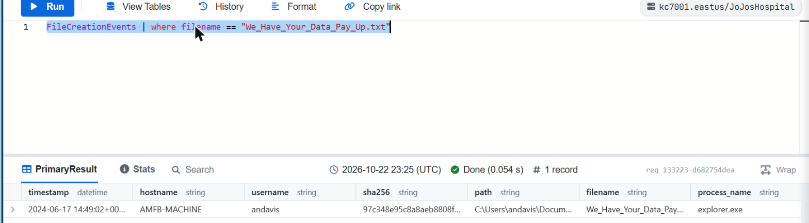
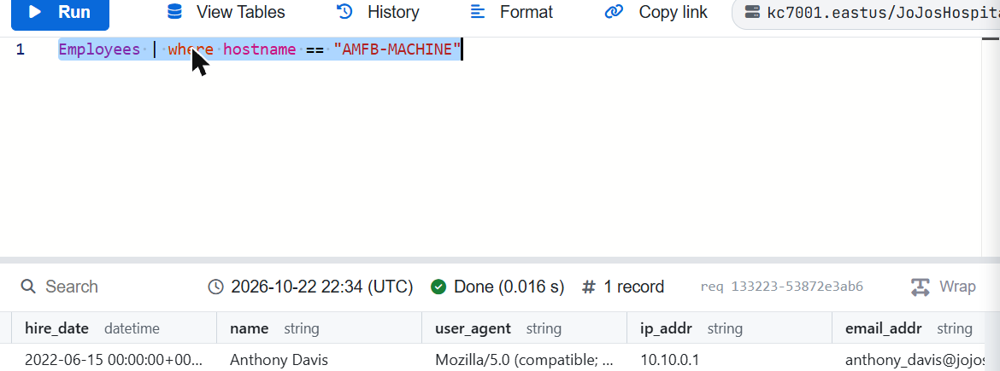
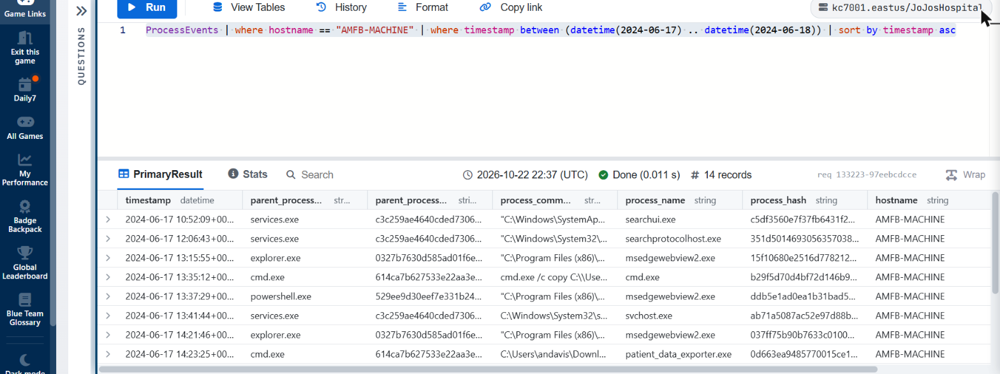
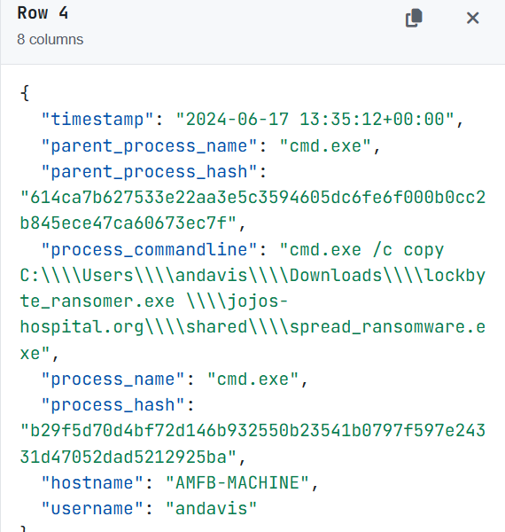
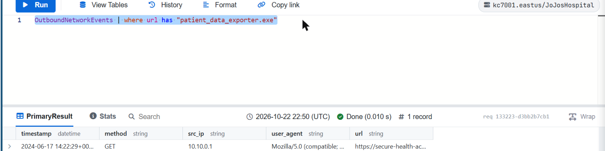
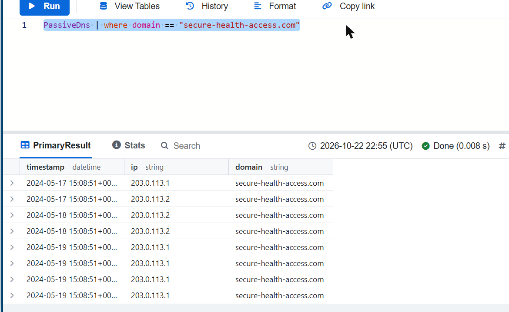
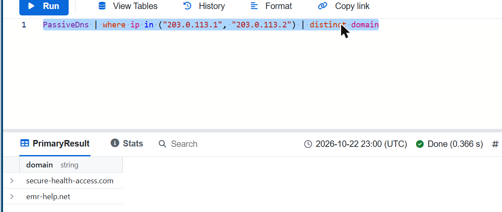
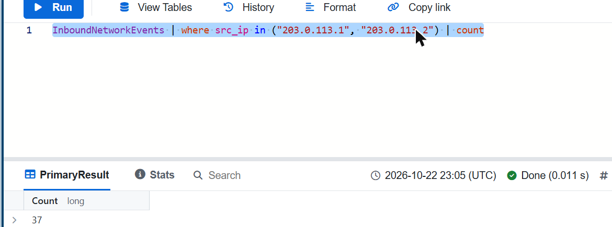
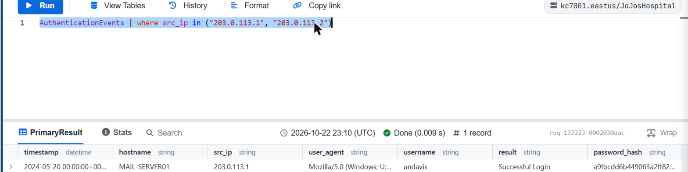

# Module 7 — Jojo's Hospital: A Ransomware Investigation

> KC7 Security Analyst I path · Difficulty: Beginner · Path completed: October 2026 · Replayed on: 2026-10-22

## Scenario

Jojo's Hospital, in Lexington, Kentucky, gets hit by a ransomware attack from a group calling itself **LockByte**. Hospital-wide files are encrypted and a ransom note demands payment within 72 hours; separately, LockByte emails individual patients, threatening to leak their medical records and Social Security numbers unless each one personally pays $10,000 — a second, patient-targeted extortion track on top of the hospital-wide one. My job is to trace the attack from the ransom note back to its origin, map how it spread across the hospital's network, and determine exactly what — if anything — was stolen.

## Investigation objectives

- Scope: how many files and hosts were actually encrypted
- Patient zero: which host, and which employee, the ransom note is tied to
- Mechanism: how the ransomware reached that host and spread to the rest of the hospital
- Impact beyond encryption: was data exfiltrated, and if so what, and to where
- Attribution: pivot on the attacker's own infrastructure (domains/IPs) to see what else they touched
- Build a timeline and an IOC list for the whole incident

## Approach

### Step 1 — How widespread is the encryption?
**Hypothesis:** ransomware typically appends a signature extension to every file it locks, so counting that extension scopes the blast radius before digging into the mechanism.
**Table used:** `FileCreationEvents` — encryption shows up as a file being (re)written, which this table records.
```kql
FileCreationEvents
| where filename endswith ".encrypted"
| count
```
**Result:** 6,420 encrypted files, across 321 distinct hosts (same filter, `| distinct hostname | count`).



**Conclusion / next pivot:** this isn't one infected machine — it's hospital-wide. I need to find the first host that got hit, since that's where the entry point will be.

### Step 2 — Finding the ransom note and its host
**Hypothesis:** the attacker dropped a literal ransom-note file somewhere, and that file's host is "patient zero."
**Table used:** `FileCreationEvents` again, filtered to the exact filename named in the ransom note text (`We_Have_Your_Data_Pay_Up.txt`).
```kql
FileCreationEvents
| where filename == "We_Have_Your_Data_Pay_Up.txt"
```
**Result:** exactly one record — SHA256 `97c348e95c8a8aeb8808f76434d73a92bbcb6b4586788365762b22624990b018`, path `C:\Users\andavis\Documents\We_Have_Your_Data_Pay_Up.txt`, created 2024-06-17T14:49:02Z by `explorer.exe`, on a single host: **AMFB-MACHINE**.



**Conclusion / next pivot:** AMFB-MACHINE is patient zero. Pivoting on that hostname should reveal whose machine it is.

### Step 3 — Attributing the host to an employee
**Hypothesis:** the `Employees` table stores a hostname-to-person mapping.
**Table used:** `Employees`.
```kql
Employees
| where hostname == "AMFB-MACHINE"
```
**Result:** **Anthony Davis**.



**Conclusion / next pivot:** now I can zoom into exactly what ran on Anthony's machine around the time of the attack.

### Step 4 — The full attack chain in one query
**Hypothesis:** every meaningful action the attacker took on Anthony's machine should show up in its process execution log, on the day the note was dropped.
**Table used:** `ProcessEvents`.
```kql
ProcessEvents
| where hostname == "AMFB-MACHINE"
| where timestamp between (datetime(2024-06-17) .. datetime(2024-06-18))
| sort by timestamp asc
```
**Result:** only 14 process events for the entire day, and nearly every one past 13:35 tells part of the story:





- **13:35:12** — `cmd.exe /c copy C:\Users\andavis\Downloads\lockbyte_ransomer.exe \\jojos-hospital.org\shared\spread_ransomware.exe` — the ransomware binary gets renamed and copied onto a hospital-wide network share. This single command is what explains the 321-host blast radius: any machine with access to that share could pick up and run `spread_ransomware.exe`.
- **14:23:25 / 14:56:02 / 15:54:53** — three separate runs of `patient_data_exporter.exe`, each pulling a different network share (current patient records, an archive of patient records, and old patient data) into a local zip file.
- **14:49:02** — (from Step 2) the ransom note itself gets dropped, timed between the second and third exfil batches — the attacker clearly ran the data theft and the extortion note in parallel, not one after the other.
- **17:18:57 / 17:30:31 / 17:31:50** — three `curl` uploads, one per zip, to `secure-health-access.com`.
- **17:36:47** — `cmd.exe /c del C:\Users\andavis\Documents\patient_data_*.zip` — the local copies get deleted immediately after upload, a basic anti-forensics step.

**Conclusion / next pivot:** this is a double-extortion ransomware attack, not just encryption — the attackers exfiltrated three full patient-data archives before (and while) locking the hospital's files.

### Step 5 — Where did the exfil tool come from?
**Hypothesis:** `patient_data_exporter.exe` isn't a legitimate hospital tool, so it had to be downloaded from somewhere.
**Table used:** `OutboundNetworkEvents`.
```kql
OutboundNetworkEvents
| where url has "patient_data_exporter.exe"
```
**Result:** one GET request to `https://secure-health-access.com/tools/patient_data_exporter.exe`, at 2024-06-17T14:22:29Z — a minute before the first export command ran.



**Conclusion / next pivot:** `secure-health-access.com` is attacker-controlled infrastructure, worth pivoting on.

### Step 6 — Pivoting on the attacker's infrastructure
**Hypothesis:** a malicious domain resolves to IP(s) that might tie to other attacker activity — PassiveDNS lets me pivot domain → IP → any other domain sharing that IP.
**Table used:** `PassiveDns`.
```kql
PassiveDns
| where domain == "secure-health-access.com"
```
**Result:** 2 distinct IPs, `203.0.113.1` and `203.0.113.2` (resolutions recorded 2024-05-17 through 05-19 — notably, over a month before the June 17 attack).



Pivoting again, on those two IPs:
```kql
PassiveDns
| where ip in ("203.0.113.1", "203.0.113.2")
| distinct domain
```
**Result:** a second domain sharing the same infrastructure — `emr-help.net`.



**Conclusion / next pivot:** I now have two IPs and two domains tied to the same attacker infrastructure — worth checking every other log source for activity from those two IPs.

### Step 7 — Did the attackers scout the hospital beforehand?
**Hypothesis:** attacker infrastructure often does reconnaissance against a target's public-facing site before an attack.
**Table used:** `InboundNetworkEvents` (requests received by the hospital's own servers).
```kql
InboundNetworkEvents
| where src_ip in ("203.0.113.1", "203.0.113.2")
| count
```
**Result:** 37 requests, including searches for how to "bypass security" and the first-ever search containing the word "patient" (`.../search=JoJo%27s+Hospital+patient+records`).



**Conclusion / next pivot:** the attackers researched the hospital's security controls and its patient-data holdings well before ever touching Anthony Davis's machine — this wasn't opportunistic, it was planned.

### Step 8 — The real point of entry
**Hypothesis:** if the attackers own this IP infrastructure, maybe they used it to log into something directly, not just browse the hospital's site.
**Table used:** `AuthenticationEvents`.
```kql
AuthenticationEvents
| where src_ip in ("203.0.113.1", "203.0.113.2")
```
**Result:** exactly one login — **2024-05-20T00:00:00Z**, hostname `MAIL-SERVER01`, username `andavis`, result "Successful Login", description "A user attempted to log in to their email."



**Conclusion:** this is the actual initial access — a full month before the ransomware was ever deployed, the attackers successfully logged into Anthony Davis's **email account** (not his workstation directly) from their own infrastructure. The module's own question set stops here, so exactly how those credentials were obtained (phishing, credential stuffing, a password leaked elsewhere) isn't something I can confirm with this data — but the month-long gap between the login (May 20) and the attack (June 17) suggests the attackers sat on that access for weeks, likely doing further reconnaissance or access expansion, before pulling the trigger.

## Attack timeline

| Date/time (UTC) | Event | Source (table) |
|---|---|---|
| 2024-05-17 – 05-19 | `secure-health-access.com` resolves to `203.0.113.1` / `.2` | PassiveDns |
| 2024-05-20 00:00:00 | Successful login to `andavis`'s email from `203.0.113.1` (host `MAIL-SERVER01`) — initial access | AuthenticationEvents |
| (undated, before 06-17) | 37 reconnaissance requests to the hospital site from `203.0.113.1`/`.2` | InboundNetworkEvents |
| 2024-06-17 13:35:12 | `lockbyte_ransomer.exe` copied to `\\jojos-hospital.org\shared` as `spread_ransomware.exe` | ProcessEvents |
| 2024-06-17 14:22:29 | `patient_data_exporter.exe` downloaded from `secure-health-access.com` | OutboundNetworkEvents |
| 2024-06-17 14:23:25 – 15:54:53 | 3 patient-data zips staged (current, archived, old records) | ProcessEvents |
| 2024-06-17 14:49:02 | Ransom note `We_Have_Your_Data_Pay_Up.txt` dropped on AMFB-MACHINE | FileCreationEvents |
| 2024-06-17 17:18:57 – 17:31:50 | 3 zips uploaded via `curl` to `secure-health-access.com` | ProcessEvents |
| 2024-06-17 17:36:47 | Local zip copies deleted (anti-forensics) | ProcessEvents |
| 2024-06-17 (ongoing) | 6,420 files encrypted across 321 hosts | FileCreationEvents |

## Indicators of Compromise (IOC)

| Type | Value | Context |
|---|---|---|
| SHA-256 | `97c348e95c8a8aeb8808f76434d73a92bbcb6b4586788365762b22624990b018` | Ransom note, `We_Have_Your_Data_Pay_Up.txt` |
| Filename | `lockbyte_ransomer.exe` | Ransomware binary (found in `Downloads`) |
| Filename | `spread_ransomware.exe` | Same binary, renamed and copied to the network share |
| Filename | `patient_data_exporter.exe` | Data-exfiltration tool |
| Domain | `secure-health-access.com` | Exfil destination and exporter-tool download source |
| Domain | `emr-help.net` | Second domain on the same attacker infrastructure |
| IP | `203.0.113.1` | Attacker infrastructure; source of the May 20 email login and recon traffic |
| IP | `203.0.113.2` | Attacker infrastructure, same domain(s) |
| Network path | `\\jojos-hospital.org\shared` | Share used to mass-distribute the ransomware |
| File extension | `.encrypted` | Marks every file LockByte encrypted |

## MITRE ATT&CK mapping

| Tactic | Technique (ID) | Observation |
|---|---|---|
| Reconnaissance | Active Scanning / Search Victim-Owned Websites (T1595 / T1594) | 37 requests from attacker IPs probing the hospital site, including "bypass security" searches |
| Initial Access | Valid Accounts (T1078) | Successful login to `andavis`'s email from attacker infrastructure, a month before deployment |
| Lateral Movement | Lateral Tool Transfer (T1570) | Ransomware binary copied to a hospital-wide network share to spread it |
| Collection | Local Data Staging (T1074.001) | Three patient-data shares pulled into local zip files before upload |
| Exfiltration | Exfiltration Over Web Service (T1567) | Three zips uploaded via `curl` to `secure-health-access.com` |
| Defense Evasion | Indicator Removal: File Deletion (T1070.004) | Local zip copies deleted immediately after upload |
| Impact | Data Encrypted for Impact (T1486) | 6,420 files encrypted across 321 hosts |
| Impact | Financial theft via double extortion | Ransom note (72h deadline) + separate $10,000-per-patient extortion threatening SSN/medical-record leaks |

*(Mapping is approximate — built for learning purposes, not a formal incident report.)*

## Defensive recommendations

- Treat a successful login from a never-before-seen external IP as worth alerting on by itself, even with no failed-login brute-force pattern preceding it — here, the single successful login from `203.0.113.1` was the entire initial-access story, and it sat unnoticed for a month.
- Restrict write access to shared network drives from standard user accounts, or at minimum alert on new `.exe` files appearing on a share — the single `copy` command that placed `spread_ransomware.exe` on `\\jojos-hospital.org\shared` is what turned one compromised laptop into a 321-host incident.
- Monitor for bulk file staging into zip/archive files followed shortly by outbound `curl`/HTTP uploads to domains outside an allowlist — this pattern (3 zips, 3 uploads, within a few hours) is a very detectable double-extortion fingerprint if watched for.
- Treat process command-line logging as a first-class detection source: 14 `ProcessEvents` rows on a single host were enough to reconstruct almost the entire attack, from lateral spread to exfiltration to anti-forensics.
- Pivot on attacker infrastructure (domain → IP → sibling domains → inbound/outbound/authentication events from those IPs) as a standard step — it's how both the reconnaissance phase and the real point of entry (the email login) were found here, neither of which the ransom note itself would have revealed.

## What I learned

- A ransom note is the end of the story, not the beginning — working backward from `FileCreationEvents` (the note file) to `Employees` (its owner) to `ProcessEvents` (everything that host actually did) reconstructed almost the entire attack chain from a single starting indicator.
- Double extortion means two different threats running on two different tracks: file encryption (which locks the hospital out) and a separate data-theft/leak threat aimed directly at patients — in the process logs, the data theft was clearly staged in parallel with the ransom note being dropped, not strictly before or after it.
- Pivoting through PassiveDNS (domain → IP → other domains on that IP) and then checking every available log source against those IPs (inbound, outbound, authentication) is what turned one download URL into a full infrastructure map and the actual initial-access finding — the attack's real starting point wasn't the ransomware at all, it was a credential compromise a month earlier.
- A process command-line log is extremely dense evidence: on a single host, 14 events were enough to see malware staging, lateral movement, data staging, exfiltration, and anti-forensics, each in its full literal command line.

## References

- KC7 Security Analyst I path — *Jojo's Hospital: A Ransomware Investigation* (https://kc7cyber.com/dashboard/paths/security-analyst-i)
- MITRE ATT&CK (https://attack.mitre.org) — technique IDs referenced above
